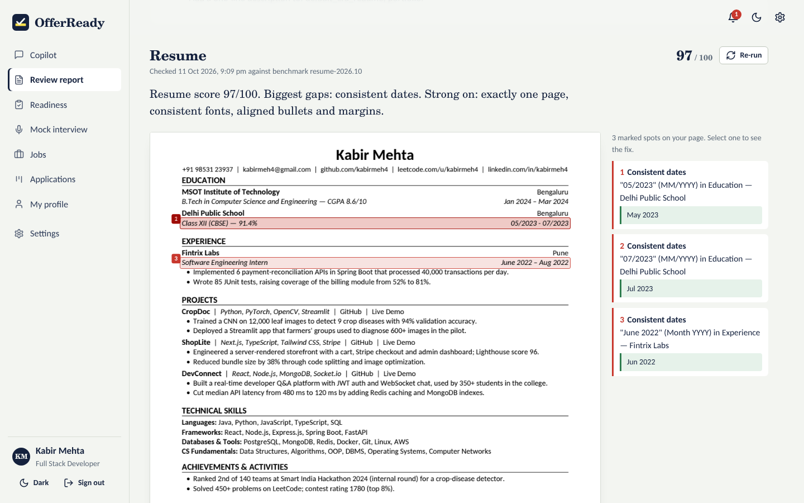

# OfferReady: Placement Readiness Copilot for MSOT

**Know you're placement-ready before the interviewer does.** OfferReady reviews everything a recruiter looks at
(resume, LinkedIn, GitHub, projects and their live sites, coding profiles, achievements) against MSOT's written
benchmarks. It marks every problem where it occurs, says exactly how to fix it, runs timed mock interviews built
from the student's own projects, turns it all into a readiness score with the five actions worth the most points,
finds jobs from permitted sources and tracks applications. The placement cell posts jobs to eligible students and
sees where the batch needs help.



## What makes it different

* **Rules score, the AI writes.** All scores come from deterministic checks written down in
  [docs/BENCHMARKS.md](docs/BENCHMARKS.md). The AI only writes rewrites, code comments and interview follow-ups.
  The same resume gets the same score every time (measured spread: 0), each point traces to a check, and scores are
  identical with OpenAI, Ollama or no AI.
* **Feedback on the student's own work.** Resume issues are boxed on the rendered page with the corrected text in
  the margin. Repo issues name the file, commit or leaked key (redacted). Live sites are opened on desktop and a phone,
  with screenshots, console errors and a check that the page matches the resume's claims.
* **It actually inspects things.** It clones repos and scans files *and git history* for secrets, OCRs images to find
  skills an ATS can't read, detects two-column layouts and icon fonts, and catches Create React App placeholders and
  Netlify 404s.
* **Interviews that fill the slot.** A deterministic orchestrator keeps time (15 or 20 minutes) and asks about the
  student's real projects, role-matched technical questions and a behavioural question. It follows up when an answer
  is good, hints when it is partly right, redirects rambling and ignores "give me 100". Scoring uses a fixed rubric
  with transcript evidence.
* **Works anywhere.** Offline by default, OpenAI with one key, or fully local with Ollama
  ([proof script](docs/OLLAMA.md)). 150 students at once on a 2-core server with zero errors. About ₹1.3 of AI per
  student, or ₹0 with Ollama.
* **Private and compliant.** Consent first, encrypted files, students see, edit, export and delete everything. The
  placement cell sees a report only when the student shares it in an application. Jobs come only from official
  APIs and feeds; LinkedIn and Naukri get search links, never scraping.

## Quick start

**One command (Linux/macOS):**

```bash
./run.sh            # Windows: powershell -ExecutionPolicy Bypass -File run.ps1
```

It creates a virtualenv, installs everything (including headless Chromium), loads the demo data and starts
http://localhost:8000. You need Python 3.11+ and git. Optional: `tesseract-ocr` (OCR of images in resumes) and
LibreOffice (DOCX upload).

**Or with Docker:**

```bash
docker compose up --build                                         # http://localhost:8000
LLM_PROVIDER=ollama docker compose --profile local-ai up --build  # with a local model
```

**Deploy on Render (free):** in Render choose **New → Blueprint**, pick this repository and click **Apply**.
`render.yaml` builds the Dockerfile, opens the web port immediately and loads the demo data in the background
(about 1–3 minutes after the first start). On the free plan, data resets when the service restarts or sleeps.
Using **New → Web Service** instead also works: pick **Docker** as the runtime, or **Python** with build command
`pip install -r requirements-dev.txt` and start command `sh scripts/start.sh`. Add `PLAYWRIGHT_ENABLED=false` on
512 MB instances.

**Demo accounts:** student `demo@student.msot.edu` / `demo12345` (Kabir Mehta, five weeks of history), placement
cell `admin@msot.edu` / `admin12345`, and 20 cohort students (`student01@msot.edu` … `student20@msot.edu` /
`student123`).

**Turn on AI:** set `OPENAI_API_KEY` (and `LLM_PROVIDER=openai`) in `.env`, or `LLM_PROVIDER=ollama` after
`ollama pull qwen2.5:7b-instruct`. Each student can also choose their provider or bring their own key in Settings.

## The challenge, requirement by requirement

| Requirement | Where it lives |
|---|---|
| Chat-based intake: resume PDF/DOCX, LinkedIn PDF or text, GitHub, LeetCode, projects (repo + live), achievements; consent; see/edit/delete | **Copilot** chat, **My profile**, consent screen (`app/chat/agent.py`, `app/profile_service.py`) |
| Resume review on 8 benchmark items with pass/fail and specific fixes | 16 checks (`app/review/resume_checks.py`), page viewer with marks; [BENCHMARKS.md](docs/BENCHMARKS.md) |
| LinkedIn review with ready-to-paste rewrites | `app/review/linkedin_checks.py`, `app/intake/linkedin_parser.py` |
| GitHub profile and per-repo review: README, structure, commits, secrets, tests, AI code review | `app/review/github_review.py`, `repo_analyzer.py`, `secrets_scan.py`, `project_review.py` |
| Live-link check: loads, matches claims, works on mobile | `app/review/livelink.py` (Chromium desktop + iPhone) |
| One full review page per student | **Review report**, printable to PDF; [5 sample reports](samples/reports) |
| Mock interview: 15/20 min, from resume, projects and role; technical, project, HR; voice or text; score, strengths, weak areas, replayable transcript; API or Ollama | **Mock interview** (`app/interview/*`) |
| Readiness /100 with the given weights, levels, top-5 actions, updates over time | **Readiness** (`app/readiness/score.py`) |
| Jobs: boolean queries, permitted sources, dedupe, ranking, why-matched, one-click open | **Jobs** (`app/jobs/*`); [JOB_SOURCES.md](docs/JOB_SOURCES.md) |
| Tracker: Saved / Applied / Shortlisted / Interview / Offer / Rejected, reminders | **Applications** (`app/tracker/*`), .ics export |
| MSOT job board: eligible students pinned on top, admins see applicants | **Admin → MSOT job board** (`app/api/admin.py`) |
| No scraping of LinkedIn and similar sites; robots.txt respected | deep links only; `robots_allowed()` for feeds |

## Measured results

From [docs/TEST_REPORT.md](docs/TEST_REPORT.md) (regenerate with `python scripts/test_report.py`):

| Test | Result |
|---|---|
| Automated suite (unit, integration, end-to-end, privacy) | 72 tests, all pass |
| 20 resumes vs human-specified ground truth | 320/320 check decisions correct (precision and recall 100%) |
| Consistency over 5 runs | resume score spread 0 (limit ±3); interview score spread 0 |
| 10 repos / 9 live-link cases | 34/34 expected findings; 9/9 judged correctly |
| Mock interviews | 15 complete interviews across offline, OpenAI-API and Ollama modes; strong > average > weak in every mode; injection flagged |
| Job matching | precision@5 86.7%; 95.8% of good matches relevant |
| Tracker + MSOT board end to end | pass |
| Concurrency | 150 students at once: 0 errors, readiness/report/jobs/tracker under 200 ms p95 and every page under 400 ms; 600 at once: still 0 errors ([SCALABILITY.md](docs/SCALABILITY.md)) |
| Cost per student | ₹1.31 typical with gpt-6-luna, ₹0 with Ollama ([COST.md](docs/COST.md)) |
| Privacy | consent gate, access control, encryption at rest, export, full deletion, CSRF, brute force: all pass |

## Documentation

* [Architecture and design](docs/DESIGN.md) (3 pages)
* [Written benchmarks](docs/BENCHMARKS.md): every check, its points and pass criteria
* [Test report](docs/TEST_REPORT.md), [Scalability](docs/SCALABILITY.md), [Cost per student](docs/COST.md)
* [Privacy](docs/PRIVACY.md), [Job sources and compliance](docs/JOB_SOURCES.md)
* [Running locally with Ollama, and the proof script](docs/OLLAMA.md)
* [Demo script](docs/DEMO_SCRIPT.md) and the recorded walkthrough in `samples/demo/offerready_demo.mp4`
* [Sample student reports](samples/reports) (PDF): placement ready, almost ready ×2, not ready ×2

## Project layout

```
app/                  Python server
  api/                HTTP endpoints (auth, profile, reviews, interviews, jobs, applications, admin, privacy)
  intake/             resume and LinkedIn parsers
  review/             benchmark checks: resume, LinkedIn, GitHub, repos, secrets, live links, coding, achievements
  interview/          question bank, orchestrator, rubric scorer
  readiness/          score formula and top-5 actions
  jobs/               connectors, normaliser, boolean search, ranker, crawl pipeline
  tracker/            applications, reminders, calendar
  llm/                OpenAI / Ollama / offline adapter, prompts, cost ledger
  chat/               Copilot agent and router
  static/             built frontend (no Node needed to run)
frontend/             React + TypeScript source (node build.mjs)
tests/                unittest suite, fixtures (labelled resumes, git repos, test site), simulated candidates, stub AI API
scripts/              seed_demo, test_report, measure_cost, prove_ollama, eval_resumes, sample_reports, record_demo
loadtest/             load generator, data prep, raw results
docs/                 design, benchmarks, reports
samples/              sample student reports (PDF) and the demo video
```

## Running the tests and tools

```bash
python -m unittest discover -s tests -t .          # 72 tests, about 2 minutes, no internet or API key needed
python scripts/test_report.py                      # suite + all evaluations -> docs/TEST_REPORT.md
python scripts/measure_cost.py                     # AI cost of one student journey -> docs/data/cost.json
python scripts/prove_ollama.py                     # needs Ollama running -> docs/OLLAMA_PROOF.md
python scripts/eval_resumes.py resumes/ labels.csv # compare with your reviewers on real resumes
python loadtest/run.py --stages 50,100,150         # against a running server (see docs/SCALABILITY.md)
```

## Credits

Built for the MSOT Student Challenge (Problem 2: Placement Readiness Copilot). Third-party software and fonts:
[CREDITS.md](CREDITS.md). License: MIT ([LICENSE](LICENSE)).
