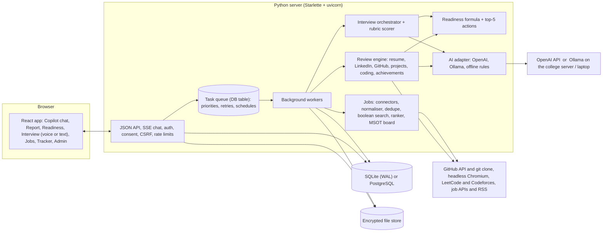

# OfferReady: architecture and design

OfferReady is a placement copilot for MSOT students and the placement cell. A student gives it their resume,
LinkedIn export, GitHub, projects and coding profiles. It reviews each one against written benchmarks, runs timed
mock interviews, turns everything into a readiness score with the five actions worth most points, finds jobs from
permitted sources, and tracks applications. The placement cell posts jobs to eligible students, sees applicants
and cohort-wide gaps.

## Design principles

1. **Rules score, the AI writes.** Every score comes from deterministic checks written down in
   [BENCHMARKS.md](BENCHMARKS.md). The language model only writes rewrites, code-review comments, interview
   follow-ups and feedback. Scores are therefore repeatable (spread 0 over five runs), explainable (each point
   traces to a check), and identical whether the AI is OpenAI, Ollama or switched off.
2. **Every finding points at evidence and says how to fix it.** A resume issue is boxed on the rendered page with
   its exact location; a repo issue names the file, line or commit; a live-site issue comes with screenshots.
3. **Works fully offline.** With no API key the product still reviews, scores, interviews (rule-based follow-ups),
   matches jobs and tracks applications. Ollama gives the full AI experience with no data leaving the machine.
4. **Privacy by default.** Consent before processing, encrypted files, students see/edit/delete/export everything,
   and the placement cell sees a report only when the student shares it in an application.
5. **Compliance over coverage.** Jobs come only from official APIs, syndication feeds and the cell's own board.
   LinkedIn, Naukri, Indeed, Internshala and Wellfound are never scraped; students get one-click search links instead.

## Architecture

**One process or many.** By default the web process also runs the worker, enough for a college on one 2-vCPU
server. To grow, run more web processes and `python -m app.worker` processes against PostgreSQL. The queue is a
database table: tasks are claimed atomically, highest priority first (what a student is waiting for comes before
slow repo clones), retried with backoff, and recovered if a worker dies.

**Frontend.** React + TypeScript, bundled with esbuild into `app/static` (no Node needed at run time). The visual
language is a marked-up paper: navy ink, a yellow highlighter for what matters, red correction marks, green ticks,
and a serif display face. Reviews read like a mentor's annotations on the student's own work.

## How each part works

| Part | Approach |
|---|---|
| **Profile intake** | The chat-first Copilot accepts anything: a resume (PDF/DOCX), a LinkedIn PDF or pasted text, GitHub/LeetCode/Codeforces links, repo and live links, achievements in plain words. A deterministic router recognises links and intents; with AI on, a tool-calling agent handles free-form requests. Each item becomes a *source* the student can see, edit, re-run or delete. |
| **Resume review** | pdfplumber word geometry, so fonts, positions and links are real, not guessed. It detects two-column reading order, learns heading styles, splits entries and bullets, extracts dates and links (annotations and plain text), and OCRs images with tesseract to find skills hidden in pictures. 16 checks in 8 benchmark groups produce pass/warn/fail, points, evidence with page coordinates, and specific fixes (e.g. which lines to cut to reach one page, the corrected date format, the suggested spelling). The page is rendered with numbered boxes over each issue. |
| **LinkedIn** | Parses the official "Save to PDF" export (or pasted text); never visits linkedin.com. Checks the headline, About, consistency with the resume, skills against the target role, custom URL and basics, then writes three ready-to-paste headlines and an About draft from the student's own facts. |
| **GitHub and projects** | GitHub REST/GraphQL for the profile (README, pins, activity, descriptions, forks). Each project repo is shallow-cloned: README quality, setup steps, screenshots, folder structure and committed junk, commit-message quality and browser uploads, tests/CI, code smells (long functions, debug prints, hard-coded localhost), and a gitleaks-style secret scan of files *and history*, with values redacted. The AI reads the main files for specific review comments; comments naming files it was not shown are dropped. |
| **Live links** | Headless Chromium at desktop and iPhone sizes: load status and time, console errors, failed assets, horizontal overflow, viewport tag, placeholder pages (CRA/Vite/Netlify 404), SPA refresh 404s, and whether the page matches the resume's claims. Screenshots are kept as evidence. |
| **Mock interview** | A deterministic orchestrator owns phases, time budgets and limits (introduction, project deep-dive from the student's own projects, technical questions from a 44-question bank matched to the target role and stack, behavioural, wrap-up). The AI only judges each answer (strong/partial/weak/don't-know/off-topic/clarify) and phrases one follow-up or hint from the allowed set. Prompt injection is detected and ignored. Voice mode uses browser speech (free) or OpenAI/Whisper. Scoring uses a fixed rubric: technical 30, projects 25, problem solving 20, communication 15, behavioural 10. It is the median of three runs at temperature 0, each dimension citing transcript turns. Without AI, the same rubric is scored from the per-turn assessments. Transcripts can be replayed. |
| **Readiness** | Resume 25, projects 25 (best three, at least two expected), interview 20, GitHub 10, coding 10, LinkedIn 5, co-curricular 5. Levels: 0–49 not ready, 50–74 almost ready, 75+ placement ready. For each failing check, the expected gain is computed exactly from the formula. Fixes that clear several checks are merged, quick wins are ranked ahead of long ones with similar gain, and at most two actions come from one component. Snapshots are kept only for settled states, so the progress chart shows real change over time. |
| **Jobs** | Connectors for Greenhouse, Lever, Ashby, SmartRecruiters, Remotive, Arbeitnow, Remote OK, The Muse, Adzuna and Jooble (with keys), RSS (robots.txt checked) and the MSOT board. Postings are normalised, cross-source duplicates merged ("also on"), and skill weights precomputed at crawl time. The student's boolean query (NOT > AND > OR, phrases, brackets) is built from their skills, role, level and cities, and they can edit it. It is evaluated with per-term set indexes. Results are ranked 45% skills + 20% role + 15% level + 10% location + 10% freshness, with "why this matched" and missing skills on every card, and one-click open to the original posting. |
| **Tracker and MSOT board** | Kanban with Saved → Applied → Shortlisted → Interview → Offer / Rejected, a status history, follow-up reminders (7 days after applying, 4 after shortlisting), interview reminders and an .ics export. MSOT jobs carry eligibility (minimum readiness, batches, branches, skills). Eligible students see them pinned on top and apply in one click; ineligible ones see why. The cell sees applicants and shared reports, and status changes appear in the student's tracker with a notification. |

## Security and privacy

Session JWT in an httpOnly SameSite cookie, CSRF header on every change, scrypt passwords, per-account brute-force
lock, CSP and security headers, Fernet encryption for every uploaded file and for students' own API keys,
row-level ownership checks on every query, an audit log for admin views of shared reports, a full export (JSON +
original files) and real deletion. Details: [PRIVACY.md](PRIVACY.md).

## Measured results

20/20 resumes match ground truth (320/320 check decisions); score spread 0 over five runs; 10 repos and 9 live-link
cases judged correctly; 15 complete interviews across offline, OpenAI-API and Ollama modes; job matching
precision@5 87%; 150 concurrent students on 2 vCPUs with 0 errors and every page under 400 ms at p95; about ₹1.3 of AI per
student with gpt-6-luna and ₹0 with Ollama. See [TEST_REPORT.md](TEST_REPORT.md), [SCALABILITY.md](SCALABILITY.md)
and [COST.md](COST.md).

## Known limits and next steps

* The resume ground truth is a labelled synthetic corpus. Before go-live, run `scripts/eval_resumes.py` on 50–100
  resumes graded by the placement cell.
* LeetCode has no official API. The public GraphQL endpoint is used gently (cached, rate-limited, can be switched
  off) and students can type their numbers instead.
* Interview quality depends on the model. 7B local models follow the JSON protocol well; the orchestrator, not the
  model, enforces timing and limits.
* For more than ~400 simultaneous active students, move to PostgreSQL and separate worker processes
  ([SCALABILITY.md](SCALABILITY.md)).
